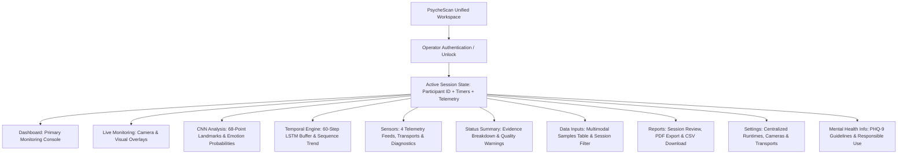
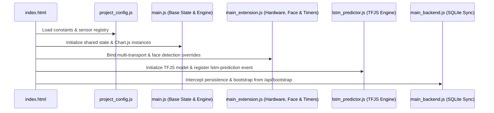
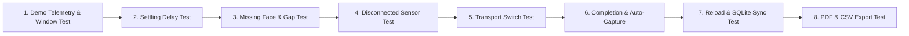

# PsycheScan Dashboard Redesign — Implementation Specification

**Document Version:** 1.0.0  
**Project:** PsycheScan — Real-Time Early Detection System for Mental Health  
**Academic Context:** Colegio de Muntinlupa · Computer Engineering Department · CpE Batch 28 · COEN3133  
**Target Platform:** Lenovo ThinkCentre M700 Mini PC / Modern Chromium Browsers (Google Chrome, Microsoft Edge)  
**Status:** Approved Architectural Specification  

---

## 1. Executive Summary, Scope & Terminology

### 1.1 Product Goal
The PsycheScan Dashboard Redesign transforms the monitoring workspace from a fragmented multi-page layout into a unified, configurable, real-time multimodal early-detection console. The platform synchronizes visual facial biomarkers (via Computer Vision CNN models) with physiological telemetry (via ESP32 hardware sensors) and sequential temporal inference (via LSTM models) into an operator-friendly clinical decision-support interface.

### 1.2 Non-Clinical-Use & Regulatory Constraint
> [!IMPORTANT]
> **Regulatory Disclaimer:** PsycheScan is strictly an investigational screening, monitoring, and decision-support tool. It is **not** a diagnostic medical device and does not provide clinical diagnoses of depression, anxiety, or other mental health disorders. All outputs, risk scores, and trend narratives must be evaluated by licensed healthcare professionals. This disclaimer must remain permanently displayed across the dashboard footer, report exports, and printed documentation.

### 1.3 Terminology
* **Operator:** The healthcare worker, barangay health aide, or researcher operating the console.
* **Participant:** The respondent or patient undergoing screening (aged 18–65).
* **Observation Window:** A configurable time duration (default: 3 minutes; selectable: 3, 4, 5 minutes or custom) during which sensor and facial data are actively collected, retained in rolling memory, and summarized for evaluation.
* **First-Reading Delay (Start Delay):** A configurable initial grace period (e.g., 5–30 seconds) immediately following session initiation, allowing physical sensors (GSR electrodes, pulse sensor, temperature probe) and facial detection to stabilize before data points qualify for observation scoring.
* **Multimodal Fusion:** The weighted integration of facial emotion confidence ($42\%$), visual fatigue indicators ($18\%$), and physiological biomarker risks ($40\%$) into an integrated score ($0\text{--}100$).
* **Missing-Face Interval:** A period during an active session where the camera feed loses facial tracking; represented as temporal visual gaps rather than zeroed values.
* **Temporal Engine (LSTM):** A 60-sample sequential neural network (running client-side via TensorFlow.js) classifying stress states into *Minimal*, *Mild*, *Moderate*, or *Severe*.

### 1.4 Target Information Architecture (IA)
The application workspace is structured around a single cohesive session model. Navigation tabs represent synchronized lenses onto the active session:



---

## 2. Primary Monitoring Workspace (Dashboard)

The **Dashboard** tab serves as the high-density command center for the operator, eliminating the need to switch tabs during an active participant observation.

```
+---------------------------------------------------------------------------------------------------------+
| Top Bar: Participant ID-01 | Session Timer: 02:45 / 03:00 | Status: OBSERVING | Delay: Settled (10s)    |
+------------------------------------+--------------------------------------------------------------------+
| Live Camera & Vision HUD           | Synchronized Multi-Sensor Timeline (Chart.js)                      |
| +--------------------------------+ | +----------------------------------------------------------------+ |
| | [ Live Video Stream ]          | | | HR (bpm)       [--/\--/\--]  Latest: 74 bpm  | State: Connected  | |
| | Overlay: Bounding Box + Mesh   | | +----------------------------------------------------------------+ |
| |                                | | | GSR / EDA (µS) [----------]  Latest: 1.05 µS | State: Connected  | |
| | Model: SSD MobileNet (Live)    | | +----------------------------------------------------------------+ |
| | Dominant: Neutral (84%)        | | | Temp (°C)      [----------]  Latest: 34.2 °C | State: Connected  | |
| | Eyebags: 18% | Wrinkles: 12%   | | +----------------------------------------------------------------+ |
| | Fatigue Indicator: Minimal     | | | Motion (g)     [---/\-----]  Latest: 0.034 g | State: Connected  | |
| +--------------------------------+ | +----------------------------------------------------------------+ |
+------------------------------------+--------------------------------------------------------------------+
| Live Stat Cards & Assessment Gauge | Temporal Trend & Session Progress                                  |
| [ Heart Rate ]  [ GSR / EDA ]      | [ Progress: 91% Completed ] [ Ready for Report Generation ]        |
| [ Temperature]  [ Motion RMS]      | LSTM State: Minimal Stress (92.4% Conf) | Data Quality: 100% Valid  |
+---------------------------------------------------------------------------------------------------------+
```

### 2.1 Workspace Components
1. **Live Camera & Vision HUD:**
   * High-definition video stream (`<video id="video">`) with synchronized canvas overlay (`<canvas id="overlay">`).
   * Real-time badges for Face Status (`Face Detected` / `Face Lost`), Active Model (`SSD MobileNet` / `TinyFace`), and Detection FPS.
   * Dominant emotion chip and visual fatigue scores (Eyebags $\%$, Wrinkles $\%$, Facial Fatigue Score).

2. **Synchronized 4-Channel Sensor Timeline:**
   * Four time-synchronized continuous line series stacked in a unified viewport:
     * **Heart Rate:** `PROJECT_CONFIG.sensors.max30102` (unit: $\text{bpm}$, baseline: $60\text{--}85\text{ bpm}$).
     * **Skin Conductance (GSR/EDA):** `PROJECT_CONFIG.sensors.gsr` (unit: $\mu\text{S}$, baseline: $0.9\text{--}1.1\ \mu\text{S}$).
     * **Peripheral Skin Temperature:** `PROJECT_CONFIG.sensors.ds18b20` (unit: $^\circ\text{C}$, baseline: $33.0\text{--}35.0\ ^\circ\text{C}$).
     * **Motion / Accelerometer RMS:** `PROJECT_CONFIG.sensors.mpu6050` (unit: $\text{g}$, minimal motion: $<0.03\text{ g}$).
   * Shared horizontal time axis bounded strictly to the active **Observation Window**.
   * Per-channel connection badges displaying live state: `Connected` (green), `Searching` (amber), `Disconnected` (gray), `Demo` (blue), or `Error` (red), along with `lastSeen` relative latency.

3. **Session Timing & Control Strip:**
   * **Observation Window Controls:** Preset toggle pills ($3\text{ min}$, $4\text{ min}$, $5\text{ min}$, and $Custom$).
   * **Countdown / Elapsed Display:** Clear visual progress bar and countdown indicator (`MM:SS`).
   * **Session Trigger Actions:** `Start Observation`, `Pause/Resume`, `Reset Window`, and `Capture Snapshot`.
   * **Start Delay Phase Indicator:** When initiated, displays an audible/visual settling countdown (`Settling sensors: 10s...`) during which incoming samples are marked as `stabilizing` and excluded from scoring calculations.

4. **Integrated Assessment Gauge & Decision Panel:**
   * Real-time display of the hybrid fusion score ($0\text{--}100$).
   * Categorical classification badge based on `PROJECT_CONFIG.severity`:
     * Minimal ($<25$)
     * Mild ($25\text{--}44$)
     * Moderate ($45\text{--}69$)
     * Severe ($\ge 70$)
   * Data Completeness indicator showing connected sensor ratio (e.g., `4/4 Sensors Active`, `Face Tracking Valid`).

---

## 3. Settings & Hardware Connection Requirements

All settings must be centralized into the **Settings** view, persisted in both browser cache (`STORAGE_KEYS.settings`) and SQLite backend (`/api/sync`), and applied without application reload.

### 3.1 Observation & Session Settings
| Parameter | Default | Permitted Values | Description |
|---|---|---|---|
| `startDelay` | $10\text{ s}$ | $0\text{ s}, 5\text{ s}, 10\text{ s}, 15\text{ s}, 30\text{ s}$ | Settling delay before recording qualifies for assessment. |
| `observationDuration` | $180\text{ s}$ | $180\text{ s}, 240\text{ s}, 300\text{ s}$, or custom | Duration of the primary evaluation window. |
| `customDurationMax` | $900\text{ s}$ | $60\text{ s}\text{ to }900\text{ s}$ ($1\text{ to }15\text{ min}$) | Enforced upper boundary for custom observation periods. |
| `autoCaptureOnComplete`| `true` | `true`, `false` | Automatically generates and saves a session record upon countdown expiry. |
| `samplingInterval` | $160\text{ ms}$ | $100\text{ ms}\text{ to }500\text{ ms}$ | Frame processing rate for face detection and sensor capture. |

### 3.2 Camera & Vision Settings
* **Camera Device Selection:** Dynamically enumerated via `navigator.mediaDevices.enumerateDevices()` into `<select id="cameraDeviceSelect">`, supporting hot-plugging.
* **Camera Facing Mode:** `auto`, `user` (front), `environment` (rear).
* **Mirror Preview:** Toggle mirroring for natural participant interaction.
* **Detection Model Profile:** `phone-strong` (SSD MobileNet v1, higher accuracy) or `standard` (TinyFaceDetector, lightweight).
* **Model Source:** `local` (`./models` directory beside `index.html`) cascading to `remote` (GitHub CDN).

### 3.3 Hardware Transport Modes
The system must support four distinct transport modes with mutually exclusive activation and transparent state machines:

```
[Disconnected] <---> [Searching] <---> [Connected]
      |                    |
      v                    v
   [Error]              [Demo Mode]
```

1. **Serial / USB (`serial`):**
   * Interface: Web Serial API (`navigator.serial`).
   * Parameters: Baud rate ($115200$), auto-reconnect flag.
   * Target: Direct USB tether to ESP32 microcontroller.
2. **Bluetooth Low Energy (`ble`):**
   * Interface: Web Bluetooth GATT (`navigator.bluetooth`).
   * Parameters: `bleServiceUuid` (`6e400001-b5a3-f393-e0a9-e50e24dcca9e`), `bleCharacteristicUuid` (`6e400003-b5a3-f393-e0a9-e50e24dcca9e`).
   * Target: Wireless Nordic UART GATT service on ESP32.
3. **Wi-Fi / WebSocket (`ws`):**
   * Interface: Standard WebSocket client (`WebSocket`).
   * Parameters: `wsUrl` (e.g., `ws://192.168.4.1:81` or configurable IP).
   * Target: ESP32 Access Point / Station TCP socket.
4. **Demo / Simulation Mode (`demo`):**
   * Interface: Internal stochastic telemetry generator.
   * Parameters: `PROJECT_CONFIG.demo` min/max boundaries.
   * Constraints: **Must** display a persistent, unmistakable `DEMO DATA — NOT REAL HARDWARE` warning banner across the dashboard and reports. Real hardware sessions must never ingest simulated data.

---

## 4. Facial Analysis Experience

### 4.1 Visual Pipeline Specification
* **Detection & Landmark Tracking:** Runs `detectSingleFace()` using SSD MobileNet v1 or TinyFaceDetector, coupled with 68-point facial landmark regression (`faceLandmark68Net`).
* **Emotion Probability Distribution:** Extracts continuous probabilities for the 7 primary Ekman facial emotions: *neutral*, *happy*, *sad*, *angry*, *fearful*, *disgusted*, *surprised*.
* **Smoothing Filter:** Applies exponential moving average (EMA) with configurable smoothing factor $\alpha = 0.4$:
  $$\text{smoothed}_t = \alpha \cdot \text{raw}_t + (1 - \alpha) \cdot \text{smoothed}_{t-1}$$
* **Visual Fatigue Biomarkers:**
  * **Eyebag Depth Score:** Ratio of under-eye lower orbital landmark distances to ocular width.
  * **Wrinkle Index:** High-frequency gradient/variance changes across glabellar and forehead regions.
  * **Facial Fatigue Score:** Composite calculation ($0\text{--}100\%$) indicating exhaustion cues.

### 4.2 Emotion-Over-Time Charting
* **Chart Architecture:** Multi-series temporal line chart (Chart.js) plotted alongside sensor timelines.
* **Preserving Temporal Comparison:** Each emotion is rendered as a distinct colored series (e.g., Happy: Green, Sad: Blue, Angry: Red, Neutral: Gray, etc.).
* **Missing-Face Interval Representation:**
  > [!IMPORTANT]
  > **No Fabricated Zeroes:** When a participant turns away or facial tracking drops, emotion probabilities must be inserted as `NaN` or `null` data points with `spanGaps: false`. This creates clear blank intervals on the timeline, preventing artificial drops to zero that would distort session metrics.

---

## 5. Tab Modernization & Cross-Tab Coherence

To prevent duplication and ensure state integrity, all tabs in `index.html` must function as synchronized views into the same underlying session:

| Tab Identifier | Reorganized Purpose & Distinct View | Shared State Dependents |
|---|---|---|
| **Dashboard** (`dashboard`) | Primary monitoring HUD: Live camera, 4-sensor timeline, countdown timer, live assessment gauge. | `state.history`, `state.sensorValues`, `state.session` |
| **Live Monitoring** (`live`) | Full-screen or expanded camera inspection, detailed landmark visualization, picture-in-picture mode. | Camera stream, overlay canvas, face detection |
| **CNN Analysis** (`cnn`) | In-depth facial diagnostic: 68-point coordinate tables, raw vs. smoothed emotion probabilities, fatigue cues. | `state.emotionRaw`, `state.emotionSmoothed`, `state.visualFatigue` |
| **Temporal Engine** (`temporal`) | LSTM sequence inspector: Visual 60-sample rolling buffer, input normalization values, LSTM class confidence. | `state.history` (last 60 samples), `lstm-prediction` event |
| **Sensors** (`sensors`) | Hardware diagnostic panel: 4 sensor cards, raw ADC/voltage values, packet rate (Hz), transport connection controls. | `state.sensors`, `state.lastPacketRaw`, transport sockets |
| **Status Summary** (`summary`) | Multimodal evidence weighting breakdown ($42/18/40$), confidence scores, sensor quality flags, clinical disclaimer. | `computeAssessment()` breakdown objects |
| **Data Inputs** (`inputs`) | Granular timestamped tabular record of multimodal samples, searchable by participant ID, exportable to raw CSV. | `state.records` |
| **Reports** (`reports`) | Completed session dossiers: printable summary, historical graphs, diagnostic narrative, PDF/CSV export buttons. | `state.reports`, `state.records` |
| **Settings** (`settings`) | Centralized control of timers, delays, thresholds, camera sources, and transport configurations. | `state.settings`, `PROJECT_CONFIG` |
| **Mental Health Info** (`info`) | Reference documentation: PHQ-9 scale mapping, Table 1 biomarker thresholds, responsible use guidelines. | Static project documentation & metadata |

---

## 6. Frontend Architecture & Codebase Reconciliation

### 6.1 Collision & Redundancy Reconciliation
Currently, `main.js` and `main_extension.js` define competing implementations of critical handlers (e.g., `captureRecord`, `bindSettings`, `applyThemeSettings`, `updateStatusPanel`, `init`). The architecture must reconcile these into a clean execution hierarchy:



### 6.2 Extended State Model Specification
`main.js` and `main_extension.js` state must be augmented to manage the redesigned observation window:

```javascript
// State extensions in main.js / main_extension.js
state.session = {
  active: false,
  startTime: null,
  elapsedMs: 0,
  windowDurationMs: 180000,   // Default 3 min (180s)
  startDelayMs: 10000,        // Default 10s delay
  isSettling: false,          // True during first-reading delay
  settlingRemainingMs: 0,
  completed: false,
  timerIntervalId: null,
  sessionId: ""
};

state.settings.observationWindow = 180; // seconds (3 min)
state.settings.startDelay = 10;         // seconds
state.settings.customDuration = 180;    // seconds

// Extended sample structure pushed to state.history
const historySample = {
  timestamp: Date.now(),
  relativeTimeMs: state.session.elapsedMs,
  sessionId: state.session.sessionId,
  isSettling: state.session.isSettling,
  source: anyTransportConnected() ? "hardware" : (state.settings.demoSensors ? "demo" : "disconnected"),
  sensors: {
    hr: state.sensorValues.hr,
    gsr: state.sensorValues.gsr,
    temp: state.sensorValues.temp,
    motion: state.sensorValues.motion
  },
  vision: {
    facePresent: state.dominantEmotion !== "No Face",
    dominantEmotion: state.dominantEmotion,
    dominantConfidence: state.dominantConfidence,
    emotions: { ...state.emotionSmoothed },
    eyebag: state.visualFatigue.eyebag,
    wrinkle: state.visualFatigue.wrinkle,
    fatigue: state.visualFatigue.fatigue
  },
  quality: {
    faceTrackingValid: state.dominantEmotion !== "No Face",
    sensorsValid: getConnectedSensorCount() === 4,
    espDataValid: state.espDataValid
  },
  assessment: {
    score: assessment.integratedScore,
    level: assessment.level
  }
};
```

### 6.3 Responsive UI System (`styles.css`)
Replace rigid desktop-fixed dimensions (`1440px`, `overflow: hidden`) with fluid, resilient responsive grid layouts:
* Mobile/Tablet: Stacked single-column monitoring view with tabbed panels.
* Desktop/Workstation: Two-column grid (Left: Camera & Vision HUD $40\%$, Right: Synchronized Timelines $60\%$).
* CSS Variables for full dynamic theme switching (`data-theme="royal-violet"` and `data-appearance="dark|light"`).

---

## 7. Data & Model Integration Pipeline

### 7.1 Telemetry Normalization Pipeline
All raw serial, BLE, WebSocket, and demo packets pass through the centralized `normalizePacket()` function in [main_extension.js](file:///d:/PD2/Code/PsycheScan-master/PsycheScan-master/main_extension.js#L519-L528):
* Aliases mapped: `eda` $\rightarrow$ `gsr`, `pulse` $\rightarrow$ `hr`, `temperature` $\rightarrow$ `temp`, `acc`/`accMag` $\rightarrow$ `motion`.
* Data validation flag: `espDataValid` set according to ESP32 onboard sensor self-tests.

### 7.2 LSTM Sequential Engine Integration
1. [lstm_predictor.js](file:///d:/PD2/Code/PsycheScan-master/PsycheScan-master/lstm_predictor.js#L50-L70) samples the last $60$ entries in `state.history` every $5000\text{ ms}$.
2. Samples must only be extracted from **stabilized** records (ignoring points where `isSettling === true`).
3. Dispatches custom DOM event:
   ```javascript
   window.dispatchEvent(new CustomEvent('lstm-prediction', { 
     detail: { class: className, confidence: confidence } 
   }));
   ```
4. Handlers on `window` update:
   * **Dashboard Temporal Badge:** Displays predicted class (e.g., `Moderate`) and percentage.
   * **Temporal Engine Tab:** Updates interactive probability bar and trend vector.
   * **Record Snapshot:** Binds current LSTM state to the session record payload.

---

## 8. Backend & Report Generation Specification

### 8.1 Data Contracts (`/api/sync` & `/api/bootstrap`)
Extend the payload schema in [server.py](file:///d:/PD2/Code/PsycheScan-master/PsycheScan-master/server.py#L170-L198) and [main_backend.js](file:///d:/PD2/Code/PsycheScan-master/PsycheScan-master/main_backend.js#L68-L76) to store full session metadata:
```json
{
  "settings": { ... },
  "auth": { ... },
  "participantCounter": 12,
  "records": [ ... ],
  "reports": [
    {
      "id": "REP-20260907-001",
      "timestamp": "2026-09-07 14:30:00",
      "participantId": "Participant ID-12",
      "sessionId": "SES-88392",
      "windowConfig": {
        "observationWindowSec": 180,
        "startDelaySec": 10,
        "completed": true
      },
      "metricsSummary": {
        "meanHr": 76.4,
        "meanGsr": 1.12,
        "meanTemp": 34.1,
        "dominantEmotion": "Neutral",
        "meanFatigue": 14.2,
        "lstmPredictedClass": "Minimal",
        "lstmConfidence": 0.89
      },
      "integratedScore": 18,
      "decision": "Minimal Concern",
      "decisionClass": "minimal",
      "qualityFlags": {
        "hardwareMode": "serial",
        "isDemo": false,
        "sensorCompleteness": "100%",
        "missingFacePercent": "2.4%"
      },
      "narrative": "Biometric parameters maintained within baseline norms throughout the 3-minute observation.",
      "disclaimer": "Screening and decision-support tool only — not a clinical diagnosis substitute."
    }
  ]
}
```

### 8.2 Offline-Friendly PDF Generation Strategy
To maintain the core requirement of complete offline capability on the Lenovo ThinkCentre M700 without external network calls:
1. **Dedicated Printable Report Layout:** Implement a `@media print` stylesheet targeting `<section id="printableReportSection">`.
2. **Action Handlers:**
   * **Save PDF Button:** Executes `window.print()` targeting pre-styled, high-contrast, multi-chart print templates.
   * **Export CSV Button:** Generates an RFC 4180-compliant `.csv` file via a client-side Blob (`new Blob([csvContent], { type: 'text/csv' })`) with download trigger.

---

## 9. Comprehensive Acceptance Criteria

| Feature Area | Verification Criteria | Status |
|---|---|---|
| **Observation Window** | 1. Operator can select 3, 4, 5-minute presets or enter a custom duration (60–900s).<br>2. Chart horizontal domain adapts dynamically to selected duration.<br>3. Countdown timer updates second-by-second and signals completion. | Required |
| **First-Reading Delay** | 1. Settling countdown (e.g., 10s) activates immediately upon session start.<br>2. Telemetry received during settling is flagged as `isSettling: true`.<br>3. Settling samples are excluded from score computation and LSTM prediction buffer. | Required |
| **Synchronized Sensors** | 1. All four channels (HR, GSR, Temp, Motion) render on synchronized time axes.<br>2. Correct engineering units (`bpm`, `µS`, `°C`, `g`) are rendered.<br>3. Per-sensor badges reflect real status (`Connected`, `Searching`, `Disconnected`, `Demo`). | Required |
| **Facial & Emotion Metrics** | 1. Live video preview displays 68-point landmarks and bounding box.<br>2. Missing face intervals produce visual line gaps, never zeroed values.<br>3. Eyebag, wrinkle, and fatigue scores update dynamically. | Required |
| **Hardware Transports** | 1. Seamless switching between Serial, BLE, WebSocket, and Demo modes.<br>2. Disconnection of any transport displays immediate visual status chip alert.<br>3. Demo mode displays unmistakable persistent warning banner. | Required |
| **LSTM Temporal Inference**| 1. Prediction triggers every 5 seconds once 60 valid post-settling samples accumulate.<br>2. Predicted class and confidence percentage are displayed in Dashboard and Temporal tabs.<br>3. Buffer completeness bar shows progress toward 60 samples. | Required |
| **Cross-Tab Consistency**| 1. All tabs display the same active participant ID, timer status, and telemetry.<br>2. Switching tabs during an active observation does not interrupt data collection or reset timers. | Required |
| **Persistence & Sync** | 1. Reloading the browser restores settings and participant counter from backend (`/api/bootstrap`).<br>2. New records sync automatically to SQLite via `/api/sync`. | Required |
| **Reporting & Export** | 1. CSV export includes timestamped multimodal rows with quality flags and metadata.<br>2. Save PDF triggers a clean, professional print layout containing graphs, metrics, and disclaimer. | Required |
| **Clinical Disclaimer** | 1. Disclaimer is clearly visible in Dashboard footer, Report preview, and PDF exports. | Required |

---

## 10. Verification & Smoke Test Plan

To validate the implementation, execute the following smoke tests using `start_server.bat` or `python server.py`:



### 10.1 Detailed Test Matrix
1. **Demo Telemetry & Window Test:** Enable Demo mode; verify all 4 sensor lines animate with synthetic values within `PROJECT_CONFIG.demo` bounds; confirm Demo banner is displayed.
2. **Settling Delay Verification:** Start a 3-minute session with a 10s settling delay; observe countdown badge `Settling: 10s... 9s...`; confirm LSTM buffer does not ingest data until 10s elapsed.
3. **Face Loss & Timeline Gap Test:** Obstruct the camera lens; verify status changes to `Face Lost`; confirm emotion line chart breaks with gaps rather than plummeting to 0.
4. **Disconnected Sensor Test:** Uncheck one sensor or pause simulated packet; confirm the corresponding channel status transitions to `Searching` or `Disconnected` and overall sync badge changes to `3/4`.
5. **Transport Switch Test:** Switch between WebSocket and Web Serial; verify that previous sockets close cleanly and status panels update without page refresh.
6. **Observation Completion & Snapshot:** Let the timer expire (00:00); confirm automatic snapshot generation, entry into the Reports table, and modal notification.
7. **Offline SQLite Persistence:** Refresh the browser; verify that participant counter, settings, and completed records persist via `/api/bootstrap`.
8. **Export Validation:** Click `Export CSV` and verify valid columns in Microsoft Excel/text editor; click `Save PDF` and confirm print layout renders without sidebar or topbar artifacts.
