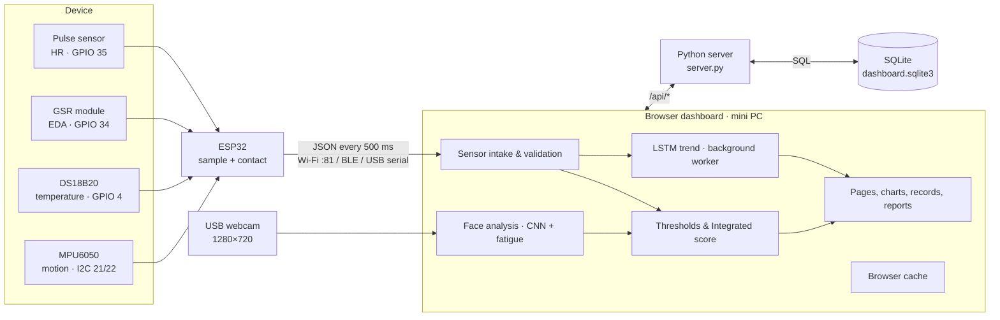
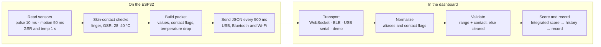
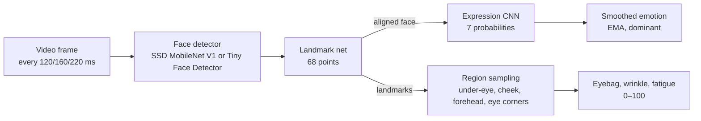
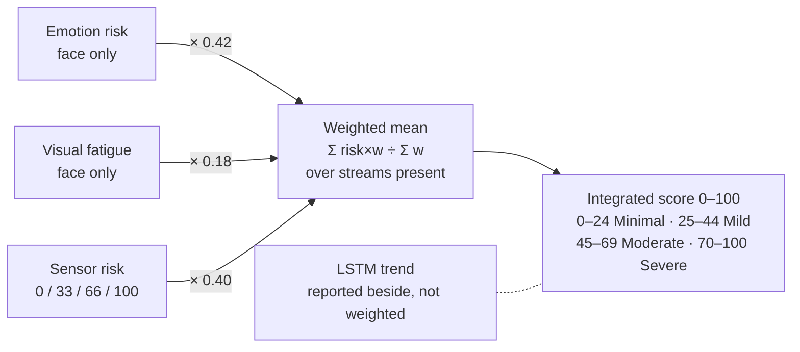
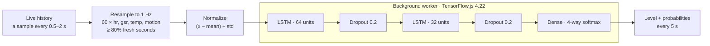
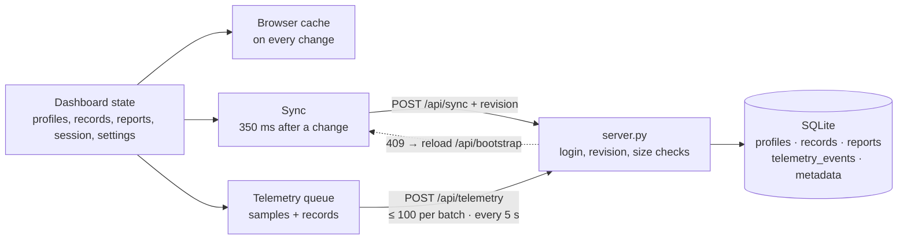
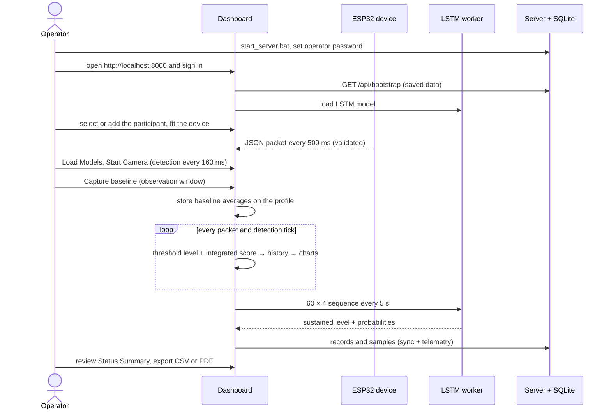

# PsycheScan: how the system works, end to end

*Real-Time Early Detection System for Mental Health Using Vital Signs Sensors Applying Hybrid CNN-LSTM Algorithms for In-Depth Analysis of Stress and Anxiety Parameters.*
Colegio de Muntinlupa · Computer Engineering · CpE Batch 26 · COEN3133

**Created by Gerald Esplana**

This document follows one reading from the device and the camera to the saved report, and names the model, rule, and file responsible at each step. PsycheScan is a screening and decision-support tool, not a clinical diagnosis.

## Contents

1. [System at a glance](#1-system-at-a-glance)
2. [Device and firmware](#2-device-and-firmware)
3. [Sensor data intake](#3-sensor-data-intake)
4. [Facial analysis (CNN)](#4-facial-analysis-cnn)
5. [Visual fatigue](#5-visual-fatigue)
6. [Biomarker thresholds](#6-biomarker-thresholds)
7. [Integrated score](#7-integrated-score)
8. [Temporal LSTM](#8-temporal-lstm)
9. [Session workflow](#9-session-workflow)
10. [Storage and server](#10-storage-and-server)
11. [User interface map](#11-user-interface-map)
12. [One session, start to end](#12-one-session-start-to-end)
13. [Files and models](#13-files-and-models)

---

## 1. System at a glance

PsycheScan screens a participant for stress and anxiety by combining two independent evidence streams:

- **The device.** It measures four vital signs: heart rate, skin conductance, peripheral temperature, and motion. An ESP32 microcontroller streams them to the dashboard.
- **The camera.** A USB webcam supplies the face. A convolutional neural network (CNN) reads the facial expression, and an image-analysis routine estimates visual fatigue.

The dashboard fuses both streams into one **Integrated score** on a four-level scale: Minimal, Mild, Moderate, Severe. Separately, an **LSTM** network reports the sustained trend of the vital signs over the last minute.

All processing runs locally on the Lenovo ThinkCentre M700 mini PC. The dashboard is a web application that runs in the browser. A small Python server stores patients, records, and reports in a SQLite database on the same machine.



## 2. Device and firmware

The ESP32 runs a cooperative loop. It reads each sensor at its own rate, checks that the sensors touch the skin, and sends the latest values every 500 ms. The device only measures: every severity decision is made by the dashboard ([Section 6](#6-biomarker-thresholds)), so the thresholds live in one place.

| Sensor | Interface | Read every | How the value is obtained | Contact check |
|---|---|---|---|---|
| Analog pulse sensor (HR) | ADC, GPIO 35 | 10 ms (100 Hz) | Adaptive-threshold beat detection on the pulse wave. The interval between beats (IBI) gives `BPM = 60000 / IBI`. Resets after 2.5 s with no beat. | Signal swing above 80 ADC counts within 200 ms (finger present) |
| GSR module (EDA) | ADC, GPIO 34 | 1 s | Average of 10 readings, scaled to microsiemens: `µS = raw / 4095 × 10` | Raw average above 50 |
| DS18B20 (temperature) | 1-Wire, GPIO 4 | 1 s | Digital °C reading. The drop is measured from the first reading taken after skin contact begins, and restarts whenever contact is lost. | Reading between 28 and 40 °C |
| MPU6050 (motion) | I²C, SDA 21 / SCL 22 | 50 ms | ±2 g accelerometer: `motion = \| √(ax² + ay² + az²) − 1 g \|` (movement with gravity removed) | Always reported while the sensor responds |

Every 500 ms the same line of JSON goes out on all three links at once:
- USB serial at 115200 baud;
- Bluetooth LE, with the device name `ESP32_StressMon` and the Nordic UART service;
- a Wi-Fi WebSocket server on port 81.

When a sensor has no skin contact, its value is sent as 0 with its contact flag set to false, and the dashboard discards it. The on-board LED toggles once per second to show the device is running.

```json
{"hr":78.0,"finger":true,"gsr":1.05,"gsrSkin":true,"temp":34.2,"tempDrop":0.10,"tempSkin":true,
 "motion":0.041,"max30102":true,"gsrConnected":true,"ds18b20":true,"mpu6050":true}
```

> **Implemented in:**
> - `ESP32/ESP32_81porsyento/ESP32_81porsyento.ino`: `readPulseSensor`, `readGSR`, `readTemperature`, `readMPU6050`, `broadcastSensorData`, and the Bluetooth and Wi-Fi setup
> - `ESP32/test_4sensors/test_4sensors.ino`: bench test for the four sensors
> - `sensor_examples/`: example packets

## 3. Sensor data intake

The dashboard accepts the same JSON packet through any of three transports, or it generates demo values for practice sessions. Every packet goes through the same normalization and validation before it can affect a score.



**Transports**

- **Wi-Fi WebSocket.** Connects to the configured URL (default `ws://10.73.86.82:81`). After a disconnect it retries in 1 s, doubling the wait each time up to 30 s.
- **Bluetooth LE.** Uses the Nordic UART service `6e400001-b5a3-f393-e0a9-e50e24dcca9e` with notifications on `6e400003-…`. Partial lines are buffered until a newline arrives.
- **USB serial.** Web Serial at 115200 baud, one JSON object per line.
- **Demo sensors.** Used only when no transport is connected. Every 2 s they produce random values: HR 60–85 bpm, GSR 0.9–1.1 µS, temperature 33–35 °C, motion 0.05–0.20 g.

**Validation rules**

- Field aliases are accepted: `eda` → gsr, `temperature` → temp, `acc` or `accMag` → motion, `pulse` → hr.
- The contact flags `max30102`, `gsrConnected` and `ds18b20` mark the matching value as touching the skin.
- Accepted ranges are HR 25–240 bpm, GSR 0–100 µS, temperature 15–45 °C, and motion 0–16 g. A value outside its range, or without skin contact, is cleared.
- A sensor that hasn't reported for 6 s is cleared and shown as Waiting or Disconnected.
- Packets longer than 8192 bytes are discarded.

> **Implemented in:**
> - `main_extension.js`: `connectWs`, `scheduleWsReconnect`, `connectBle`, `processPacketChunk`, `normalizePacket`, `isValidSensorValue`, `applyIncomingPacket`, `updateSensorPresence`, `simulateSensors`
> - `main.js`: `connectSerial`, `readSerialLoop`
> - `project_config.js`: `hardware`, `biomarkers`, `demo`, `runtime`

## 4. Facial analysis (CNN)

The facial stream uses pretrained convolutional networks from the face-api.js library, running in the browser on the mini PC. On every detection tick the system:

1. finds one face;
2. locates 68 facial landmarks;
3. classifies the expression into seven emotions.



| Model | Type | Role | Used when |
|---|---|---|---|
| SSD MobileNet V1 | Single-shot detector CNN | Finds the face box (one face, minimum confidence 0.35) | Detection profile "Strong" or "External Cam Strong" (the default) |
| Tiny Face Detector | Lightweight detector CNN | Finds the face box. Input size is 320, 416 or 512 px (default 512). | "Standard" profile (confidence 0.45), or if SSD can't load |
| Face Landmark 68 Net | CNN regressor | 68 points on the eyes, brows, nose, mouth and jaw | Every detected face |
| Face Expression Net | CNN classifier | Probabilities for neutral, happy, sad, angry, fearful, disgusted and surprised | Every detected face |

The model weights load from two places: the face-api.js model host and the local `models/` folder. The Model source setting decides which is tried first; the other is the fallback.

Raw expression probabilities are smoothed with an exponential moving average before use:

```
smoothed = smoothed × α + raw × (1 − α)      α = 0.25 (low), 0.40 (balanced, default), 0.60 (strong)
dominant emotion = the class with the highest smoothed probability; confidence = that probability × 100
```

When no face is found:
- the emotion values reset to zero;
- the dominant emotion becomes "No Face";
- the facial stream drops out of the Integrated score until a face returns.

> **Implemented in:**
> - `main_extension.js`: `loadModels`, `startCamera`, `runDetectionFrame`
> - `main.js`: `smoothExpressions`, `getDominantExpression`, `drawDetection`, `restartDetectionLoop`, `stopCamera`
> - `models/`: face-api.js weight files

## 5. Visual fatigue

Visual fatigue is measured from the pixels around the eyes, positioned using the 68 landmarks. Two cues are combined:
- **eye bags:** darker skin under the eyes;
- **wrinkles:** extra fine texture on the forehead and at the eye corners.

Each cue is compared with the cheek of the same person in the same frame, so differences in lighting cancel out.

1. **Brightness** of a region is its mean luma: `Y = 0.299 R + 0.587 G + 0.114 B`.
2. **Texture** of a region is the mean absolute luma difference between each pixel and its right and lower neighbours.
3. The face must be large enough: the average eye width must be at least 18 px. A detail factor scales the scores down for small faces.

```
detail   = clamp((eye width − 18) / 22, 0.15, 1)
eyebag   = clamp( clamp(cheek Y − under-eye Y, 0, 25) × 4.6 × detail, 0, 100)
wrinkle  = clamp( clamp(mean(forehead, eye-corner texture) − cheek texture, 0, 14) × 9.2 × detail, 0, 100)
fatigue  = 0.58 × eyebag + 0.42 × wrinkle          (each then smoothed with the same α as the emotions)
```

Each percentage is labelled with the facial bands: 0–24 Minimal, 25–49 Mild, 50–74 Moderate, 75–100 Severe.

> **Implemented in:** `main.js`: `computeVisualFatigue`, `sampleRegionLuma`, `sampleTextureScore`, `getBounds`, `getSeverityLabelFromPercent`

## 6. Biomarker thresholds

Each vital sign is classified on its own using the validated thresholds (Table 1).

- **Heart rate and GSR** are judged two ways: by the absolute reading, and by the percentage rise over the patient's captured baseline. The sensor takes the more severe of the two, so a participant with a low resting heart rate is still flagged when it climbs sharply.
- **Temperature** is judged as a drop, because peripheral skin temperature falls under stress. The drop comes from the device packet; otherwise it is the captured baseline minus the current reading.

| Biomarker | Minimal | Mild | Moderate | Severe | Accepted range |
|---|---|---|---|---|---|
| Heart rate (bpm) | 60–85 (baseline) | 86–95 or +10% | 96–105 or +15–20% | > 105 or > +20% | 25–240 |
| GSR / EDA (µS) | 0.9–1.1 | 1.2–2.4 or +20–40% | 2.5–4.0 or +50–100% | > 4.0 or > +100% (up to +400%) | 0–100 |
| Peripheral skin temperature (°C) | 0.0 to −0.2 | −0.3 to −0.8 | −0.9 to −1.5 | ≤ −1.6 | 15–45 °C reading |
| Motion (RMS, g) | 0.00–0.05 | 0.06–0.10 | 0.11–0.20 | > 0.20 | 0–16 |
| Facial scores (%) | 0–24 | 25–49 | 50–74 | 75–100 | 0–100 |
| Integrated score (/100) | 0–24 | 25–44 | 45–69 | 70–100 | 0–100 |

**Reading the boundaries**
- A level's lower value counts as that level: 86 bpm is Mild.
- Severe begins strictly above the Moderate maximum: 105 bpm is Moderate, 105.5 bpm is Severe.
- A rise of exactly +20% in heart rate, or exactly +100% in GSR, stays Moderate.
- The percentage rules apply once the patient has a captured baseline.

The combined sensor level is a vote. It appears as "Threshold" on the Dashboard and as "ESP32 threshold stress" in the Status Summary.

- Each sensor with valid skin contact casts a vote for its own level; GSR casts two.
- The most severe level that receives any vote becomes the sensor level.
- With no valid sensor, it shows "Waiting for sensor".

> **Implemented in:**
> - `project_config.js`: `biomarkers`, `severity.score`, `severity.percentBands`
> - `main.js`: `classifyBiomarkerSeverity`, `classifySensorStress`, `getIntegratedSeverityLabel`

## 7. Integrated score

The Integrated score is a weighted score-level fusion of three risks, each on a 0–100 scale. Only the streams that are present take part, and their weights are rescaled to sum to 1. That way the score stays meaningful when the camera sees no face, or when no sensor is connected.



```
emotion risk = clamp(100 × (sad + angry + fearful + 0.8 × disgusted + 0.35 × surprised), 0, 100)
               + 0.3 × confidence   if the dominant emotion is Sad, Angry, Fearful or Disgusted   (capped at 100)
sensor risk  = 0 (Minimal) · 33 (Mild) · 66 (Moderate) · 100 (Severe)   from the sensor vote in Section 6
Integrated   = (0.42·emotion + 0.18·fatigue + 0.40·sensor) ÷ (sum of the weights of the streams present)
```

Two temporal indicators come from the recent history of Integrated scores:

- **Trend.** The average of the last 6 samples is compared with the 6 before. A change above +4 is Rising, below −4 is Falling, and anything else is Stable.
- **Temporal stability.** `clamp(1 − variance / 900, 0.12, 0.97)` over the last 6 samples. It is shown with a High, Medium or Low label that follows the severity level.

> **Implemented in:** `main.js`: `computeAssessment`, `updateMetrics`. The weights are in `project_config.js` → `fusion`.

## 8. Temporal LSTM

The LSTM (long short-term memory) network is the temporal half of the CNN-LSTM design.

- It reads the last 60 seconds of all four vital signs as one sequence.
- It classifies the sustained level as Minimal, Mild, Moderate or Severe.
- Because it looks at the whole minute, a brief spike, such as a finger slipping off the pulse sensor, doesn't change its answer. The instant threshold level, by contrast, may flicker.



**Input preparation**

- History samples are placed on a one-second grid. Each second takes the latest complete reading, as long as that reading is no more than 3 s old.
- A prediction runs only when:
  - the oldest second is filled, and
  - at least 80% of the 60 seconds have fresh readings.

  Until then the badge counts up, for example "16/60 S".
- Values are normalized with the mean and standard deviation saved at training time.

**Training**

- The current model is a bootstrap model. It was trained on 16,000 synthetic 60-second sequences generated within the Table 1 ranges, with spikes, ramps and noise added.
- Each sequence is labelled with its worst sustained level, using the absolute Table 1 bands:
  - for HR, GSR and motion, the median of the last 30 s;
  - for temperature, the decline across the window.

  The percentage rules need a patient baseline, so they're applied by the threshold level, not by the LSTM.
- On held-out synthetic sequences it agrees with that rule 91.3% of the time.
- To retrain on labelled participant sessions, run `train_lstm.py`. It uses the same architecture and replaces the model files.

**Where the result appears**

- On the Dashboard, as the "LSTM 60 s" badge next to "Threshold".
- In the Status Summary, as "LSTM sustained trend".
- In Settings, with its confidence.

The LSTM runs in a separate browser worker, so it never competes with the face models for the same TensorFlow engine. Its result is reported **alongside** the Integrated score and is not part of the weighted mean.

> **Implemented in:**
> - `lstm_predictor.js` (main page): `buildLstmSequence`, `runLstmPrediction`, `loadLstmModel`
> - `lstm_worker.js`: inference, using `vendor/tf.min.js`
> - `tfjs_lstm_model/`, `lstm_norm_params.json`, `label_map.json`: the model files
> - `train_lstm_synthetic.py`, `train_lstm.py`, `lstm_tfjs_export.py`: training and export
> - `main_extension.js`: `renderLstmStatus`

## 9. Session workflow

**Patient profiles**
- Each participant gets a profile identified by a name or code, which must be unique.
- Profiles can be added, viewed, renamed and deleted from Manage patients. Deleting a profile also removes its records, reports and stored readings.
- Monitoring and baseline capture require an active patient, so every reading is linked to one person.

**Baseline capture**
- The length follows the Observation window: 3, 4 or 5 minutes, or a custom 1–60 minutes.
- While the capture runs, the session is in the *baseline* phase. Afterwards it moves to the *questionnaire* phase.
- At the end, the system stores these values on the profile:
  - the averages of HR, GSR, temperature and motion;
  - the mean Integrated score;
  - the face detection rate and the dominant expression;
  - the fatigue, wrinkle and eyebag averages.
- The baseline temperature becomes the reference for the temperature drop.

**Live history and charts**
- A history sample, holding all sensor, face and score values, is kept at the History sampling rate: 0.5, 1 (default) or 2 s.
- The charts show a rolling 2-minute window, from −120 s to now.
- The First reading delay (none, 10, 30 or 60 s) holds back history and records while the participant settles.

**Records and reports**
- With Auto-capture on, a record is saved at most every 3 s. It is saved only when the face confidence is at least 30% or a sensor is connected.
- Each record holds:
  - the time and the patient;
  - the emotion and its confidence;
  - the four vital signs;
  - the eyebag, wrinkle and fatigue scores;
  - the Integrated score, its level, and a short narrative.

  A matching report row is created for each record.
- Exports: a CSV of all records, a CSV per patient, and a printable PDF report that includes the charts.

> **Implemented in:**
> - `main.js`: `startBaselineCapture`, `finalizeBaseline`, `pushHistory`, `getWindowHistory`, `exportCsv`, `savePdf`
> - `main_extension.js`: `addPatientProfile`, `updateActivePatient`, `deleteActivePatient`, `completeBaselineProfile`, `captureRecord`, `exportPatientCsv`

## 10. Storage and server

Data lives in two places:
- The browser keeps a working copy, so monitoring continues if the server is briefly unavailable.
- The Python server keeps the permanent copy in SQLite.



Each sync carries the revision number the browser last saw. If another window saved first, the server answers 409, and the browser reloads the latest data instead of overwriting it.

The telemetry queue is also sent early, as soon as 20 events are waiting. It holds at most 1000 events.

| Endpoint | Purpose |
|---|---|
| `GET /api/auth-config` | Tells the login screen whether sign-in is required (open to everyone) |
| `POST /api/login` · `/api/logout` | Exchanges the operator password for a session token (valid 8 hours), and ends it |
| `GET /api/bootstrap` | Returns settings, profiles, records, reports, the session, per-patient face summaries, and the data revision |
| `POST /api/sync` | Saves the full working state if the revision matches |
| `POST /api/telemetry` | Stores batches of history samples and records |
| `POST /api/profiles/create` · `/update` · `/delete` | Patient management. Names must be unique, ignoring letter case. |
| `GET /api/health` | Database table and row counts |

**Access control**
- In secure mode, the operator sets a password when the server starts. Any operator ID plus that password signs in.
- The token is kept only in the current browser tab and sent with every API call.
- After 5 failed sign-ins within 60 s, that address is blocked briefly. At most 32 sessions are kept.
- Requests must come from the same site that served the page. Request bodies are limited to 1 MB.
- Local test mode skips sign-in, but only accepts connections from the same computer.

**Starting the system**
- `start_server.bat`:
  1. checks for Python 3.10 or newer;
  2. asks whether to use local test mode;
  3. prompts for the operator password.
- `server.py`:
  1. copies the dashboard files into `public/`;
  2. prepares the database;
  3. prints the address to open, for example `http://localhost:8000`.
- Stored readings older than 30 days are removed at startup.

> **Implemented in:**
> - `main_backend.js`: `login`, `hydrate`, `sync`, `syncNow`, `persistTelemetry`, `flushTelemetry`, `createProfile`, `updateProfile`, `deleteProfile`
> - `server.py`: `init_db`, `build_bootstrap_payload`, `build_face_summaries`, `_store_sync`, `_store_telemetry`, `_validate_host_origin`, `prepare_public_assets`

## 11. User interface map

| Page | What it shows | Pipeline stage |
|---|---|---|
| Dashboard | Baseline summary; camera preview with landmarks; patient picker, Manage patients, Capture baseline; Load Models, Start Camera, Stop; fatigue, wrinkle and eyebag scores; four rolling sensor charts with level badges; the Threshold and LSTM 60 s badges; the emotion trend chart | Sections 3–9 |
| Patient Profiles | Directory of patients; a profile window with tabs, baseline values, records, reports, and a CSV download | Section 9 |
| Live Monitoring Hub | Integrated level, face confidence, temporal stability, sensor sync (n of 4); live feed; emotion probability bars; the normal baseline record and comparison; biometric timeline; detection and capture settings | Sections 4, 7, 9 |
| Sensors | Connection status of each sensor; Wi-Fi and Bluetooth settings; connect and disconnect buttons; packet format; the last packet received | Sections 2–3 |
| Status Summary | Current level with a narrative; Integrated score; dominant emotion; sensor evidence; threshold level; LSTM trend; fatigue cues; interpretation guide | Sections 6–8 |
| Mental Health Info | Research objective, hardware, thresholds, team, validation approach (PHQ-9), ethics | Context |
| Reports | Report table; Export CSV, Save PDF, Clear Records; captured data inputs and record details | Section 9 |
| Settings | Theme and appearance; camera source and facing; detection interval, detector size, profile, model source, smoothing; observation window, first reading delay, history sampling; auto-capture and demo sensors; system information | All |

## 12. One session, start to end



A qualified reviewer makes the final interpretation.

## 13. Files and models

### Models

| Model | Input | Output | Runs in | Files |
|---|---|---|---|---|
| SSD MobileNet V1 | Video frame | Face box + score | Browser (face-api.js) | `models/ssd_mobilenetv1_model-*` |
| Tiny Face Detector | Frame at 320–512 px | Face box + score | Browser (face-api.js) | `models/tiny_face_detector_model-*` |
| Face Landmark 68 Net | Face crop | 68 (x, y) points | Browser (face-api.js) | `models/face_landmark_68_model-*` |
| Face Expression Net | Aligned face | 7 emotion probabilities | Browser (face-api.js) | `models/face_expression_model-*` |
| Visual fatigue estimator | Frame + landmarks | Eyebag, wrinkle, fatigue 0–100 | Browser (rule-based image analysis) | `main.js` |
| Threshold classifier | HR, GSR, temperature drop, motion | Level per sensor + vote | Browser | `project_config.js`, `main.js` |
| Integrated score | Emotion, fatigue and sensor risks | Score 0–100 + level | Browser | `main.js` |
| Sensor LSTM | 60 × 4 sequence at 1 Hz | 4 level probabilities | Browser worker (TensorFlow.js 4.22) | `tfjs_lstm_model/` |

### Project files

| File or folder | Role |
|---|---|
| `index.html` | Page structure: login screen, sidebar, all pages and dialogs |
| `styles.css` | Visual design: nine color themes, light and dark modes, layouts for every screen size |
| `project_config.js` | The single source of thresholds, fusion weights, timings, hardware settings and project details |
| `main.js` | Core state, charts, classification, Integrated score, visual fatigue, baseline, serial connection, exports |
| `main_extension.js` | Patients, records and reports; the face detection loop; Bluetooth and Wi-Fi; packet handling; settings; startup |
| `main_backend.js` | Sign-in, loading saved data, sync, the telemetry queue |
| `lstm_predictor.js` · `lstm_worker.js` | LSTM input preparation (on the page) and inference (in the background worker) |
| `vendor/tf.min.js` | Local copy of TensorFlow.js 4.22 for the LSTM worker |
| `tfjs_lstm_model/` · `lstm_norm_params.json` · `label_map.json` | LSTM weights, normalization values and class order |
| `models/` | face-api.js model weights. It also holds an exported emotion model (`.tflite`) and a face recognition model, which the dashboard doesn't load. |
| `server.py` | Local web server, API, sign-in, SQLite storage |
| `start_server.bat` · `start_server.sh` | Start-up scripts for Windows and Linux |
| `public/` | Copy of the dashboard files served to the browser, refreshed at every server start |
| `data/` | `dashboard.sqlite3` (the live database), backups, and `create_database.py` (builds a separate sample database) |
| `ESP32/ESP32_81porsyento/` | Device firmware (USB, Bluetooth and Wi-Fi) |
| `ESP32/test_4sensors/` · `ESP32_81porsyento.ino` | Four-sensor bench test, and an earlier Wi-Fi-only firmware version |
| `sensor_examples/` | Example packets and an Arduino serial example |
| `train_lstm.py` · `train_lstm_synthetic.py` · `lstm_tfjs_export.py` | LSTM training on participant data, the synthetic bootstrap training, and the browser export |
| `prepare_lstm_data.py` · `convert_model*.bat` | Earlier data preparation and conversion helpers |
| `lstm_model_files/` | Backup of the previous model, and the check vectors that confirm the browser model matches Keras |
| `cnn-lstm-mental-health-records.csv` | Records exported from earlier sessions |
| `check_db.py` | Prints the database tables and row counts |
| `docs/` | Notes, run instructions, design specification, model and dataset references, baseline exports |
| `assets/logo.png` | Application logo |
| `requirements.txt` | Python packages for model training and export |

---

PsycheScan is intended for participants aged 18–65 who have given informed consent. Its results are benchmarked against PHQ-9 and do not replace assessment by a qualified professional. Data stays on the local machine, in line with RA 10173 (the Data Privacy Act of 2012).
